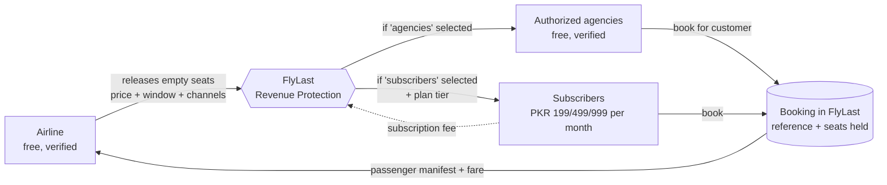
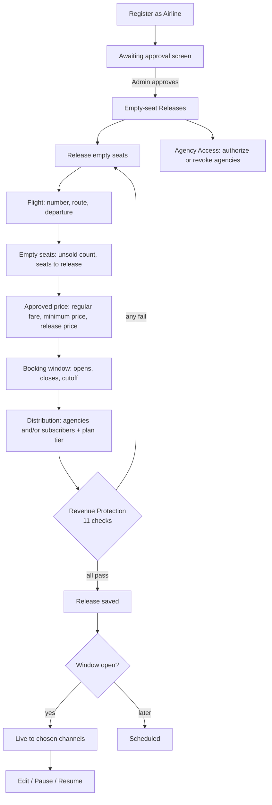
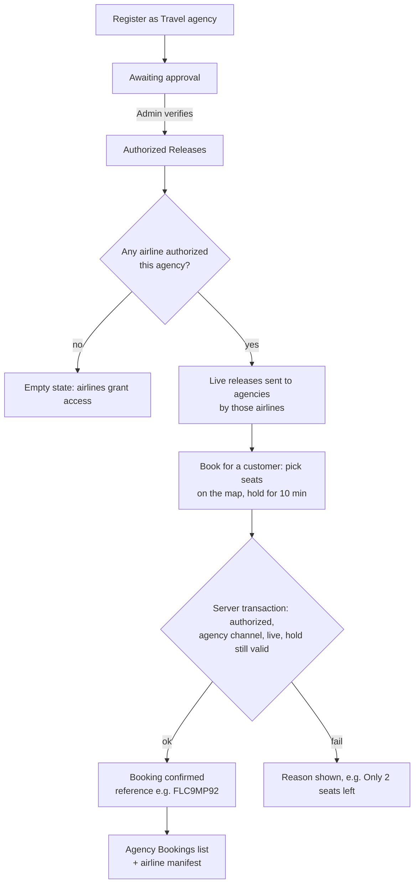
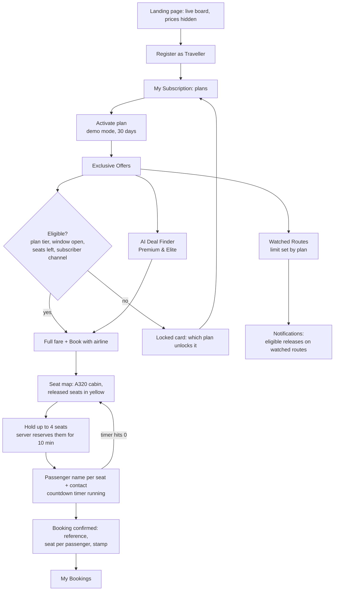
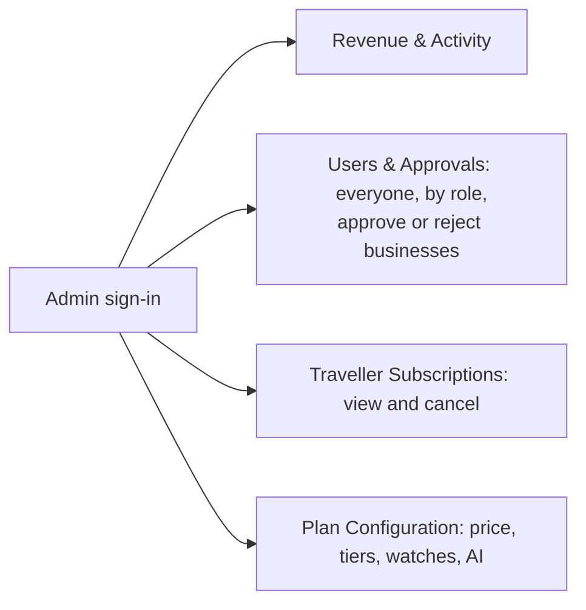

# FlyLast: business model and user flows

## The model in one paragraph

Every flight has seats that are still unsold close to departure, and an empty seat earns the airline nothing once the doors close. FlyLast lets an airline **release some of those empty seats** at a price it approves, for a booking window it sets. FlyLast then distributes each release only to the channels the airline picks:

1. **Authorized travel agencies.** They are registered, verified by FlyLast and authorized by the airline. They pay **no subscription** and book for their customers at the airline's price.
2. **Individual subscribers.** These are travellers on a paid plan (Basic PKR 199, Premium PKR 499, Elite PKR 999 per month). They discover releases, get notified on routes they watch, and book eligible seats.

Agencies and subscribers **book inside FlyLast**: pick seats, enter passenger names, get a booking reference. Seats are taken atomically, so a seat can't be sold twice, and the airline sees every passenger in its manifest. The fare is the airline's money (demo mode takes no payment; in production it's charged on the airline's behalf). FlyLast's revenue is **traveller subscriptions only**.

| Party | Pays FlyLast | Gets |
|---|---|---|
| Airline | Nothing | Revenue from seats that would fly empty, full control, no public discounting |
| Travel agency | Nothing | Extra inventory to sell to its customers |
| Traveller | Monthly subscription | Access to last-minute releases, alerts, AI Deal Finder |
| FlyLast | — | Subscription revenue (future: commission, where an airline agrees by contract) |

---

## Roles at a glance

| Role | How they join | Approval | Can subscribe |
|---|---|---|---|
| Airline | Self-register (free) | FlyLast admin | No |
| Travel agency | Self-register (free) | FlyLast admin, then each airline authorizes it | No |
| Traveller | Self-register (free account) | Instant | **Yes, the only role that can** |
| Admin | Created by FlyLast | — | No |

---

## Flow 1: Airline releases empty seats

The Revenue Protection checks: the route is valid; the price is ≥ the minimum approved price, < the regular fare, and ≤70% off; released seats are ≤ unsold seats; the window opens before it closes, and closes ≤ the cutoff; the cutoff is ≥2h before departure; the release is ≤72h before departure; the booking link is https; and at least one channel is selected.

## Flow 2: Travel agency sells a release

Agencies never see the airline's floor price and can't change the price, seats or window. Up to 9 seats per booking.

## Flow 3: Traveller subscribes and books

Locked cards are sent without price or booking link. It isn't a visual blur over data the browser already has.

**Seat holds.** Picking seats and clicking *Hold* reserves those exact seats on the server for 10 minutes (set `NEXT_PUBLIC_SEAT_HOLD_SECONDS=45` to show expiry live). Everyone else sees them as held, and the seat map refreshes every 8 seconds. Booking only succeeds while the hold is valid. If the timer runs out, the seats are released automatically and the user goes back to the map. The seat map never reveals who holds a seat.

## Booking features (travellers and agencies)

| Feature | What it does |
|---|---|
| Seat map | A320 cabin, 30 rows A–F, exit rows marked. Every seat is a button with its type (window, middle or aisle) and legroom described for screen readers. |
| How booking works | Step-by-step instructions inside the booking dialog (collapsible, remembered per browser), plus a hint on each step. |
| Seat us together | Picks adjacent seats for a party: one side of a row first, then across the aisle, then consecutive rows. Says so if seats can't be side by side. |
| + Window / + Aisle | Adds the front-most free seat of that type. |
| Exit-row notice | Shown when an exit-row seat is picked (15+, willing to assist). |
| Seat hold + timer | The server reserves the exact seats for 10 minutes, and others see them as held. The countdown bar turns red and pulses in the last minute. On expiry the seats are released and you return to the map with your picks kept. |
| Live seat map | Refreshes every 8 seconds while you choose. |
| Print e-ticket | One boarding-pass stub per passenger: route, flight, seat, reference. |
| Cancel booking | Allowed until the airline's booking cutoff. The exact seats go back on sale, and the manifest and stats update. |

## Flow 4: Admin

The Revenue & Activity page shows:
- **FlyLast revenue:** traveller subscriptions, split by plan.
- **Users:** total users, travellers, airlines, agencies and pending approvals.
- **Marketplace activity:** live releases, bookings, seats booked by channel and by route, and recent bookings.
- **Fare value to airlines:** shown separately and labelled as not FlyLast revenue.

---

## Screens

| Role | Screens |
|---|---|
| Public | Landing (live board, seat-map story, channels, who pays, plans), Sign in, Register (Traveller / Airline / Travel agency) |
| Airline | Empty-seat Releases (form + Revenue Protection + list), Bookings & Manifest, Agency Access |
| Travel agency | Authorized Releases, Agency Bookings |
| Traveller | Exclusive Offers, My Bookings, My Subscription (plans + history), Watched Routes, AI Deal Finder, Notifications |
| Admin | Revenue & Activity, Users & Approvals, Traveller Subscriptions, Plan Configuration |
| Pending business | Awaiting approval |

---

## 5-minute hackathon demo script

Run `npm run seed` first. Logins use password `demo1234`.

1. **Landing (45s).**
   - Point at the split-flap board: live releases, with prices hidden.
   - Scroll the seat map: 14 empty seats, 8 released, split between agencies and subscribers, then booked, with PKR 328,000 recovered.
2. **Airline joins (30s).** Register → Airline "Indus Jet". The account lands on *Awaiting approval*. Mention that it's free, with no subscription.
3. **Admin verifies (15s).** Sign in as `admin@flylast.demo`, open Approvals and approve Indus Jet.
4. **Airline releases seats (60s).** Sign in as Indus Jet, then Release empty seats: KHI→DXB, 14 unsold, release 8.
   - Type a price below the floor: the checklist goes red and Release is blocked.
   - Fix the price, tick both channels, choose Premium & Elite, and click Release.
   - Open Agency Access and authorize Safar Travels.
5. **Agency sells (30s).** Sign in as `agency@flylast.demo`. On IJ-512, click **Book for a customer**, then:
   - Choose 3 people and click **Seat us together**: three adjacent seats light up. Click **Hold 3 seats** and the countdown starts.
   - Enter a passenger name per seat and a customer phone number, then click Confirm.
   - The Confirmed stamp shows each passenger's seat.
6. **Traveller (75s).**
   - Register as a traveller: everything is locked.
   - Activate Premium (demo mode): IJ-512 unlocks, while Elite-only offers stay locked.
   - In AI Deal Finder, search "Dubai under 50,000", then click **Choose seats**. The agency's 3 seats now show as booked. Click **+ Window**, hold, enter a name and confirm.
   - In My Bookings, click **Print e-ticket**. Optionally click **Cancel booking**: the seat goes back on sale.
   - Sign in as Indus Jet again and open **Bookings & Manifest**: both bookings, with passengers and channel.
7. **Admin (30s).** Revenue & Activity shows total users, subscription revenue (travellers only), and seats booked by agencies vs subscribers. Users & Approvals lists everyone.

**Closing line:** *"Airlines turn seats that would fly empty into revenue without public discounting. Agencies get free inventory. Travellers pay a small subscription to get there first. That subscription is FlyLast's business."*
